<!-- Generated by node film/build.mjs from film/content.mjs. Do not edit by hand. -->

<a href="https://olwtelet.vercel.app/en/"></a>

<a href="https://www.integratek.com.br/">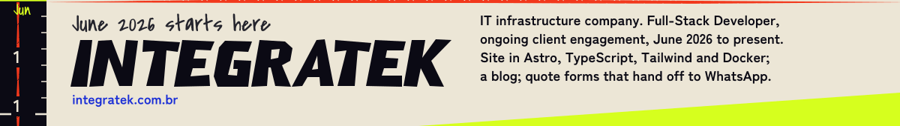</a>
<a href="https://github.com/Olwtelet/AgentForge">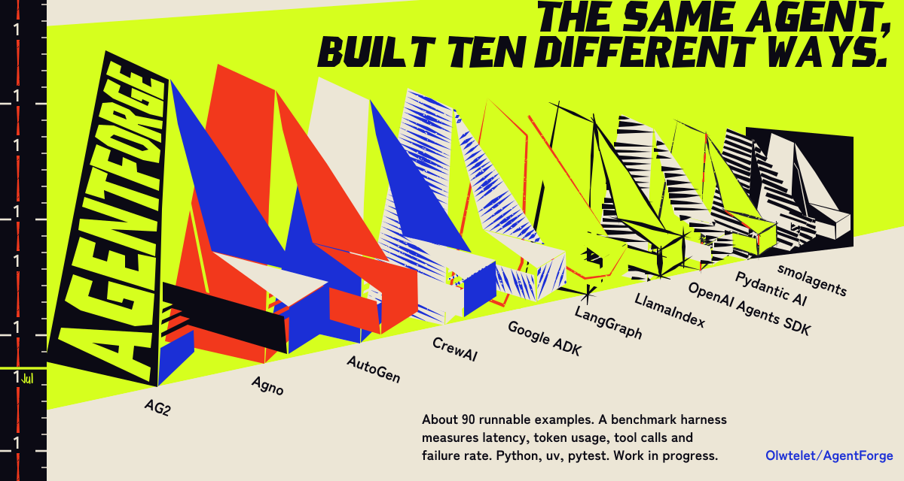</a>
<a href="https://github.com/Olwtelet/Argus">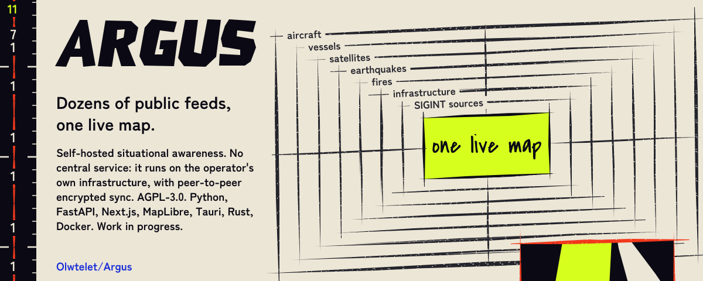</a>
<a href="https://github.com/Olwtelet/Resumex">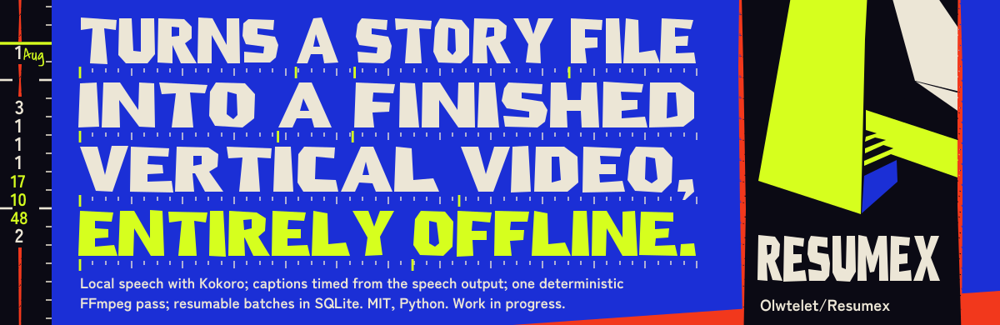</a>
<a href="https://github.com/Olwtelet/Stardew-Anti-Cheat">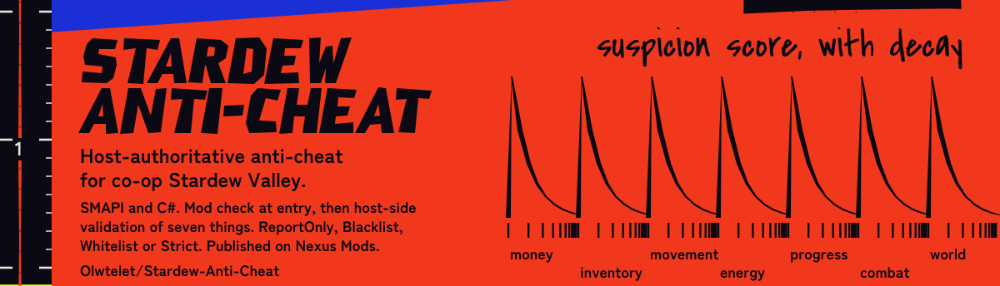</a>
<a href="https://ordfall.vercel.app/en">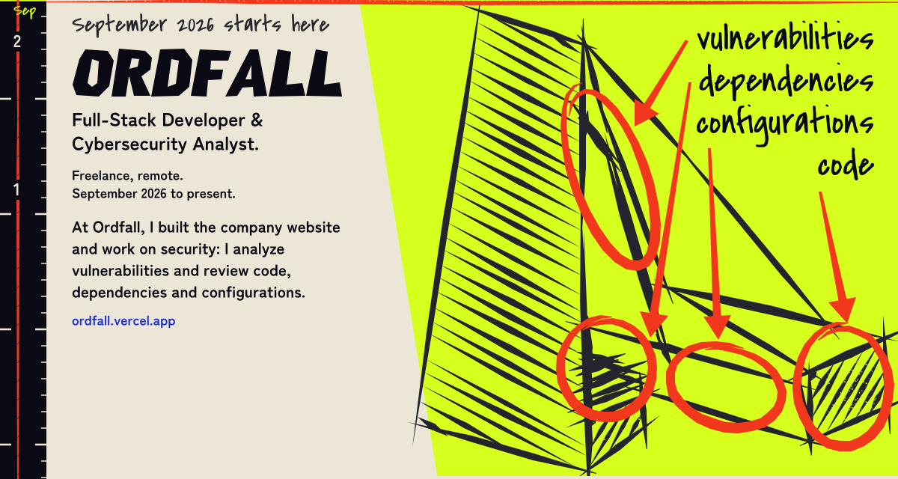</a>
<a href="https://github.com/Olwtelet/Obsidian-Second-Brain">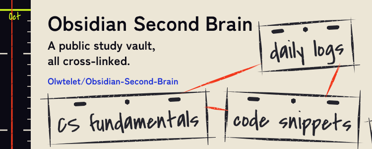</a><a href="https://olwtelet.vercel.app/en/resume/">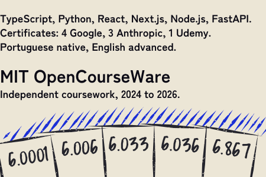</a>

<a href="https://ordfall.vercel.app/en">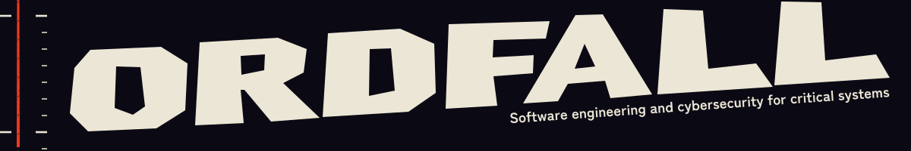</a>
<a href="https://www.integratek.com.br/">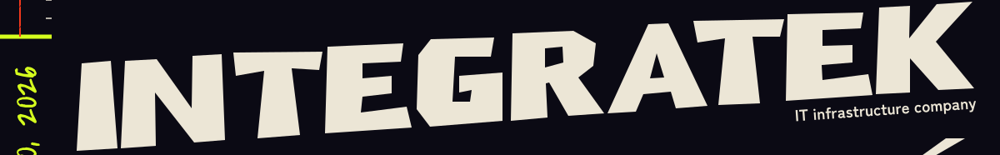</a>
<a href="https://rochaesa.com.br/">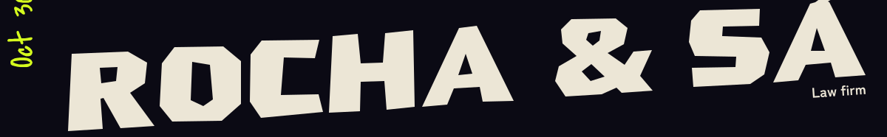</a>
<a href="https://thalitarodrigues.com/">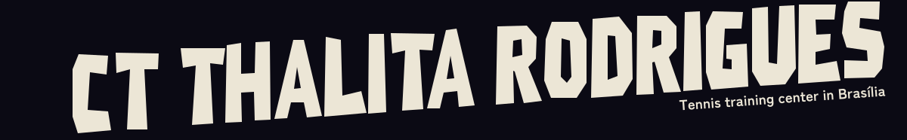</a>
<a href="https://instituto-politecnico-do-brasil.vercel.app">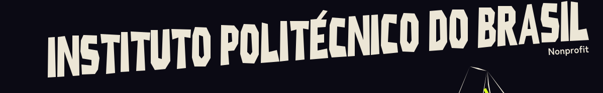</a>

Isaac Rodrigues. [Portfolio](https://olwtelet.vercel.app/en/), [resume](https://olwtelet.vercel.app/en/resume/), [olwtelet@outlook.com](mailto:olwtelet@outlook.com).

The same page, as plain text

**Isaac Rodrigues.** Computer Science student and full-stack developer in Brasília, Brazil, focused on applied AI and cybersecurity. Olwtelet is my gaming handle and the name I put on my work.

A demo proves that software works once. What I care about is whether it keeps working with bad data, unexpected use and someone trying to break in.

At Ordfall, I built the company website and work on security: I analyze vulnerabilities and review code, dependencies and configurations. I also built websites for a law firm, a tennis training center, a nonprofit and Integratek.

With AI, I use only what I can test, observe and constrain. In AgentForge, one of my open-source projects, I implement the same agent in ten frameworks and measure latency, token usage and failure rate.

**Work.** [Ordfall](https://ordfall.vercel.app/en), which builds and secures software for critical systems: Full-Stack Developer & Cybersecurity Analyst, freelance, remote, September 2026 to present. [Integratek](https://www.integratek.com.br/), an IT infrastructure company: Full-Stack Developer, ongoing client engagement, June 2026 to present; site in Astro, TypeScript, Tailwind and Docker, a blog, quote forms that hand off to WhatsApp.

**Open source.** [Argus](https://github.com/Olwtelet/Argus): self-hosted situational awareness, dozens of public feeds in one live map: aircraft, vessels, satellites, earthquakes, fires, infrastructure and SIGINT sources. No central service; it runs on the operator's own infrastructure, with peer-to-peer encrypted sync. AGPL-3.0. Python, FastAPI, Next.js, MapLibre, Tauri, Rust, Docker. Work in progress.

[AgentForge](https://github.com/Olwtelet/AgentForge): the same agent, built ten different ways, in AG2, Agno, AutoGen, CrewAI, Google ADK, LangGraph, LlamaIndex, OpenAI Agents SDK, Pydantic AI and smolagents. About 90 runnable examples; a benchmark harness measures latency, token usage, tool calls and failure rate. Python, uv, pytest. Work in progress.

[Resumex](https://github.com/Olwtelet/Resumex): turns a story file into a finished vertical video, entirely offline. Local speech with Kokoro, captions timed from the speech output, one deterministic FFmpeg pass, resumable batches in SQLite. MIT, Python. Work in progress.

[Obsidian Second Brain](https://github.com/Olwtelet/Obsidian-Second-Brain): a public study vault of CS fundamentals, code snippets and daily logs, all cross-linked. Work in progress.

[Stardew Anti-Cheat](https://github.com/Olwtelet/Stardew-Anti-Cheat): host-authoritative anti-cheat for Stardew Valley co-op, SMAPI and C#. Mod check at entry, then host-side validation of money, inventory, movement, energy, progress, combat and world, with a suspicion score that decays. ReportOnly, Blacklist, Whitelist or Strict. Published on Nexus Mods.

**Websites.** [Rocha & Sá](https://rochaesa.com.br/), a law firm. [CT Thalita Rodrigues](https://thalitarodrigues.com/), a tennis training center in Brasília. [Instituto Politécnico do Brasil](https://instituto-politecnico-do-brasil.vercel.app), a nonprofit. [Integratek](https://www.integratek.com.br/). [Ordfall](https://ordfall.vercel.app/en).

**Stack and study.** TypeScript, Python, React, Next.js, Node.js, FastAPI. Independent CS coursework through MIT OpenCourseWare: 6.0001, 6.006, 6.033, 6.036, 6.867 (2024 to 2026). [Certificates](https://olwtelet.vercel.app/en/certificates/): Google (Linux and SQL; Networks and Network Security; Manage Security Risks; Foundations of Cybersecurity), Anthropic (Claude with Vertex AI; Claude with Amazon Bedrock; Building with the Claude API), Udemy (Algoritmos e Lógica de Programação). Portuguese (native), English (advanced).

**Elsewhere.** [LinkedIn](https://www.linkedin.com/in/olwtelet/), [GitHub](https://github.com/Olwtelet), [Konect](https://konect.gg/olwtelet), [ORCID](https://orcid.org/0009-0008-2485-7398), [projects](https://olwtelet.vercel.app/en/projects/).

**The strip.** The black strip down the left edge of the art has one row for each day from October 31, 2025 to October 30, 2026. A number is that day's contributions on GitHub; a red line is a day without any. 269 in all, longest run 8 days.

